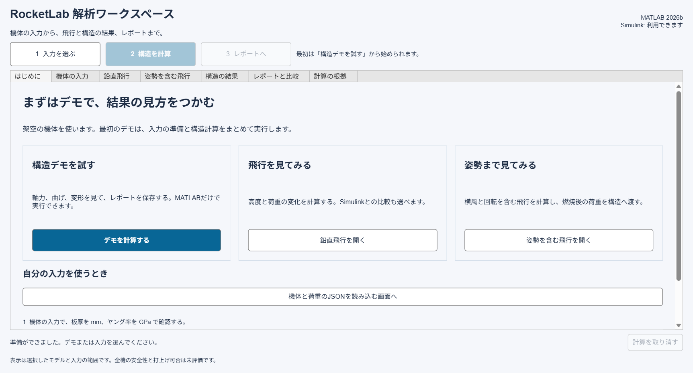

# RocketLab MATLAB

機体の入力から飛行、梁の構造解析、レポートまでを操作できる日本語のMATLABアプリです。
同梱する入力は、すべて動作確認用の架空データです。

A Japanese MATLAB desktop workspace for flight, beam loads, deformation, and reports, with synthetic examples and optional Simulink comparison.

## 最初の操作

1. MATLABを導入したWindowsで、`Start.bat`をダブルクリックします。
2. 最初の画面の「デモを計算する」を押します。
3. 「構造の結果」で力、曲げ、変形、部材ごとの評価を確認します。
4. 「3 レポートへ」から保存します。「保存先のフォルダを開く」でHTMLを確認できます。

自分の入力を使う場合は「機体の入力」で機体JSONと荷重JSONを選びます。
例は`data/demo`にあります。機体と荷重を組として管理してください。



## 必要な環境

- MATLAB。動作確認対象はR2026bです。Windows用ランチャーを同梱しています。
- 鉛直飛行のSimulink比較にはSimulinkが必要です。
- 姿勢を含む飛行のSimulink比較にはAerospace Blocksetも必要です。
- MATLAB用の計算とGUIは、Simulinkなしでも利用できます。

MATLABと追加製品は別途利用資格が必要です。本リポジトリにはそれらの本体を同梱しません。
Windows以外では、MATLABの現在のフォルダーを本プロジェクトにして`launch_app`を実行してください。
非Windowsでのハッシュ計算にはJava VMが必要です。
Windows以外でのGUI動作は未検証です。

## 操作とモデル

[操作ガイド](docs/USER_GUIDE.md)に、入力の単位と結果の読み方をまとめています。
計算結果は毎回`outputs`内の別フォルダへ保存します。
レポートには、モデルの仮定、同時刻の荷重、許容値、出典と未評価範囲を保存します。

| 機能 | 計算範囲 |
|---|---|
| 構造 | 等方円管の区分梁、2方向の曲げ、軸力、ねじり、相対変形、接合回転ばね |
| 鉛直飛行 | 架空機体の鉛直1次元飛行と、同一時刻の軸荷重 |
| 姿勢を含む飛行 | 固定重心の6自由度、質量と慣性の変化、一定風、有限時間の自由飛行 |
| 飛行から構造 | 鉛直モデルの自由飛行、6自由度モデルの燃焼終了後の荷重 |
| 比較 | MATLABとSimulinkの比較、同じ荷重を使う板厚比較 |

重心移動、レール拘束、燃焼中の6自由度構造荷重、分離、開傘、局部シェル座屈、詳細FEM、空力弾性は未対応です。
数値計算の一致と、実機の予測精度や全機の安全性の確認は別です。
全機判定は未評価として表示します。

## 検証を実行する

```matlab
startup_project
run_tests
```

任意製品が未導入の場合、対応するテストは未完了になります。
同梱の[検証記録](docs/VERIFICATION.md)には、実行した環境と件数を記載します。

公開対象の内容は、Python 3で次のように点検できます。

```text
python tools/check_public.py
```

## 開発と公開

[開発時の確認事項](CONTRIBUTING.md)と[GitHubへの公開手順](docs/PUBLISH.md)を参照してください。
自分の実測値、個人情報、利用許可がない資料を追加する場合は、公開対象から除外してください。
このリポジトリの履歴は、公開対象のソースだけで開始します。

## ライセンス

本リポジトリの自作コードは[MIT License](LICENSE)で提供します。
MATLABとMathWorks製品の利用条件は、それぞれの製品ライセンスに従います。
