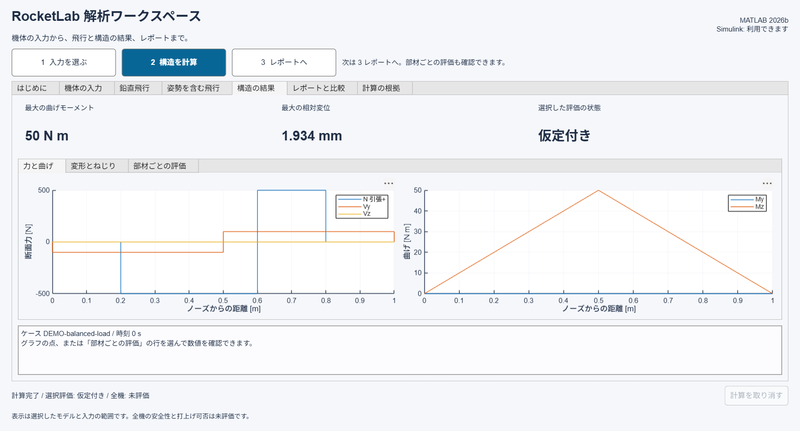

# 入力からレポートまで

## デモの結果を確認する

「はじめに」で「デモを計算する」を押すと、架空の機体と釣り合った荷重を読み込み、構造を計算します。
画面は「構造の結果」へ移ります。
上部に最大曲げ、最大相対変位、選択した評価の状態が表示されます。

「力と曲げ」には断面力を、「変形とねじり」には相対変形とねじりを表示します。
「部材ごとの評価」で需要、許容値、安全率、状態を確認できます。
グラフの点や表の行を選ぶと、その位置と時刻の数値を画面下部に表示します。
全データと出典は「計算の根拠」で確認できます。

## 板厚を変えて再計算する

「1 入力を選ぶ」で「機体の入力」に戻ります。
「かんたん設定」では板厚をmm、ヤング率をGPa、密度をkg/m3で編集します。
計算用の値はSI単位へ変換されます。
JSONファイルとレポートに保存する入力はSI単位です。画面の2 mmはJSONでは0.002 m、70 GPaは70000000000 Paになります。
元のSI単位を直接確認する場合は「詳細の入力」を開きます。

入力を編集すると、以前の結果と保存済みレポートへのボタンを無効にします。
「2 構造を計算」を押すと、新しい入力の結果を確認できます。
負の板厚など、形状として成立しない編集は採用されません。
飛行から受け渡した構成は編集できません。変更する場合は飛行から計算し直します。

## CSVから自分の機体を入力する

「機体の入力」の「CSVから入力」で、部材表と部品表を選択します。
全長・改訂・位置基準を入力すると、総質量と軸方向重心を確認し、機体JSONを保存できます。
構造計算の荷重は別途選択します。部品質量だけから荷重を作ることはありません。
[CSVの記入方法と操作](CSV_INPUT.md)を参照してください。

## 飛行と構造をつなぐ

小さい画面では、タブ内をスクロールして下部のイベント表と説明を確認できます。
グラフの高さは、画面が小さくても読み取れるように確保しています。

「鉛直飛行」では、MATLABによるデモ、またはSimulinkとの比較を選びます。
計算後に時刻を選び、「この時刻の構造を確認する」を押します。
最大動圧、最大速度、最大推力、最大軸力は異なる時刻になり得ます。

「姿勢を含む飛行」では、架空機体の自由飛行を4秒間計算します。
NED座標とスカラー先頭のHamiltonクォータニオンを使います。
構造への受渡しは燃焼終了後に限定します。
表示される最大曲げは、その区間内の記録サンプルを対象としています。
全飛行における最大構造荷重や、全時刻の最大応力を表すものではありません。

## レポートを保存する

「3 レポートへ」から「解析レポートを保存する」を押します。
保存先のフォルダを開き、`report.html`をダブルクリックします。
数表、図、入力、判定、同時刻の荷重を同じフォルダに保存します。
保存済みの結果を上書きせず、実行ごとに別のフォルダを作ります。

## 状態の読み方

| 状態 | 意味 |
|---|---|
| 仮定付き | デモなど、仮定した入力による結果 |
| 要求充足 | 選択した評価の需要が、指定した許容値と要求係数を満たす |
| 要求未達 | 選択した要求を満たしていない |
| 未評価あり | 必要な入力や許容値が不足している |
| 荷重なし | その評価に対応する需要がない |
| 全機未評価 | 本アプリの選択評価だけで全機の安全性は決められない |
